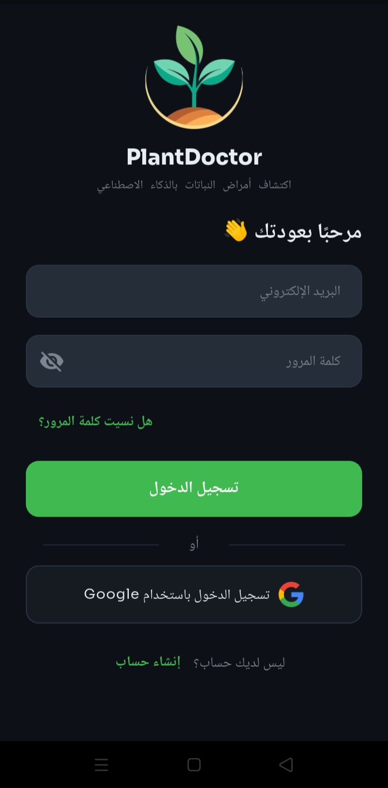
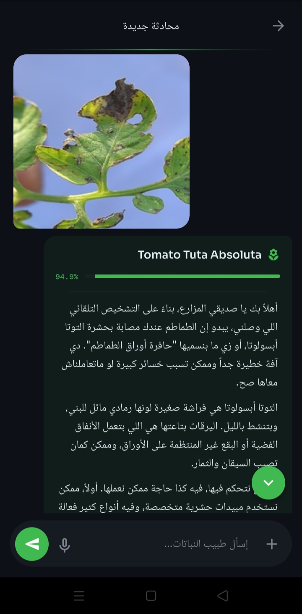
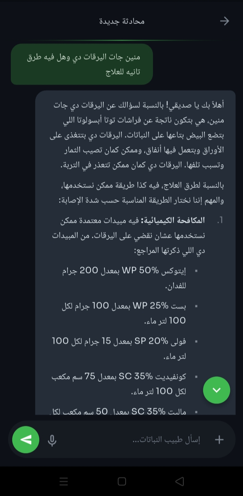
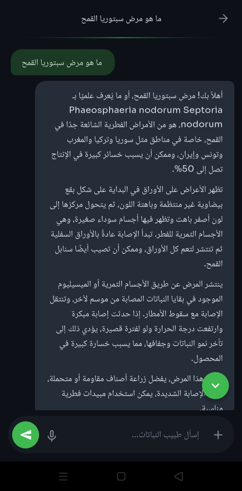
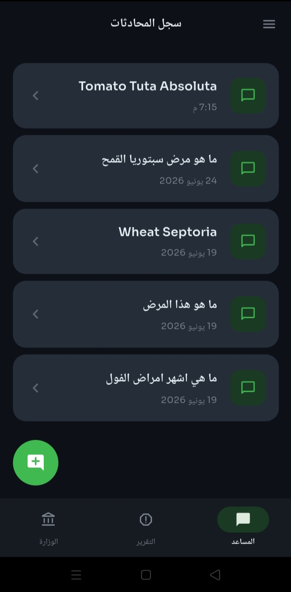
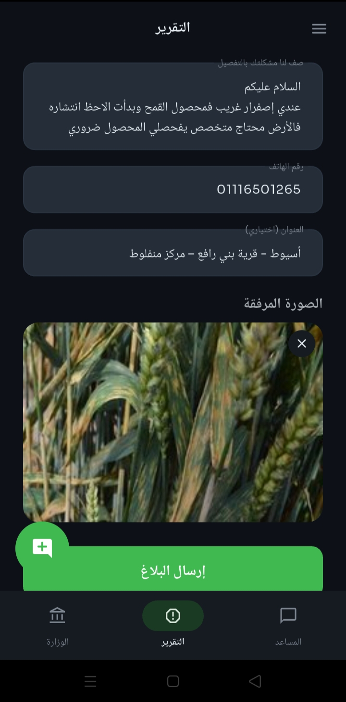

# PlantDoctor

A mobile application built with BLoC, Clean Architecture, Hive for local persistence, TensorFlow Lite for local plant disease classification, and Cloudinary for remote media management.

> **Engineering Note:** This application was developed as a graduation project to demonstrate a production-ready mobile engineering workflow, showcasing clean architecture boundaries, on-device machine learning, offline-first sync state machines, and key-wrapped local storage encryption.

---

<p align="center">
  
  
  
  
  
  
  
</p>

## Highlights

- **Clean Architecture & Domain-Driven Design:** Strictly decoupled feature-first structure separating UI presentation, domain entities/use cases, and data repositories.
- **On-Device Inference Isolates:** Real-time leaf disease classification via a custom TFLite interpreter running on background Dart isolates, supporting GPU delegate acceleration and FP16/INT8 quantized model fallback.
- **Out-of-Distribution (OOD) Filtering:** Employs a confidence threshold of `0.65` to handle unknown plant states, automatically fallback-tagging classification outliers as "Unknown Disease".
- **AES-Encrypted Offline Cache:** Local chats, messages, and reports are persisted securely via Hive, using AES-256 keys dynamically generated and stored in the Android KeyStore/iOS Keychain via `flutter_secure_storage`.
- **Intelligent Connectivity Probing:** Combines `connectivity_plus` interface listeners with an end-to-end backend reachability machine. Employs a 4-second cache TTL to avoid redundant pings, validating active status against the FastAPI RAG `/health` endpoint and falling back to direct server-only Firestore queries.
- **Offline-First Transaction Queue:** Safely caches and queues pending chat messages, agricultural reports, and image assets when offline, triggering automatic sequential background synchronization when actual host reachability transitions to online.
- **Cloudinary Media Upload Manager:** Offline diagnostic image uploads and crop reports are managed via separate custom Cloudinary presets. Images are first uploaded and converted to HTTPS URLs, which are then passed to Firestore and the RAG model.
- **Unified Topic-Based Notifications:** Wraps FCM and `flutter_local_notifications` into a single subscription service, routing via dynamic topics (`all_users`, locales, inactivity groups) and managing foreground notifications overlay and terminated-app launcher intents.
- **Location-Aware Geocoding:** Automatically resolves geographical coordinates into specific administrative governorates offline and registers them dynamically inside agricultural reports.
- **Over-the-Air Hot Patching:** Integrated with Shorebird for dynamic, hot-code updates without requiring full App Store or Google Play Store re-releases.

---

## Overview

PlantDoctor integrates local artificial intelligence with a conversational Retrieval-Augmented Generation (RAG) backend to support agricultural health diagnostics. The system operates on an offline-first philosophy: users can capture images, diagnose diseases, write notes, and submit reporting logs without network access. Once an active connection is detected, the application background worker resolves Cloudinary media uploads and synchronizes local records with Firestore and the RAG server.

---

## Key Features

- **Multi-Factor Authentication:** Email-password authentication and Google Sign-In with full email verification and secure password recovery routines.
- **RAG-Driven Diagnostics Chat:** Conversational sessions with a RAG-backed agricultural expert, accepting both natural language prompts and plant leaf images as context.
- **Real-Time Image Classification:** On-device image processing using quantized TFLite models to output immediate disease labels and confidence scores.
- **Robust Offline Reporting:** Complete report documentation containing local images, descriptions, and automatic geocoded locations, queued for transmission.
- **Ministry Information Access:** Seamless in-app WebView integration loading external bulletins, resource pages, and advisory documents from the Ministry of Agriculture.
- **Hydrated Settings Persistence:** Real-time theme mode switching, localization (English/Arabic), and user preferences persisted across app sessions via `hydrated_bloc`.
- **System Resilience:** Secure local file system caching, automatic JWT token refreshes, and push notification triggers for system updates.

---

## Screenshots / Demo

Below are snapshots demonstrating the core user interface and mobile application flows:

<div align="center">
  <table border="0">
    <tr>
      <td></td>
      <td></td>
      <td></td>
      <td></td>
    </tr>
    <tr>
      <td></td>
      <td></td>
      <td></td>
      <td></td>
    </tr>
  </table>
</div>

---

## Architecture

The project is structured according to Clean Architecture guidelines to ensure separation of concerns, unit testability, and decoupling from framework-specific dependencies.

```text
┌────────────────────────────────────────────────────────┐
│                  PRESENTATION LAYER                    │
│   UI Widgets  ◄──►  Blocs / Cubits  ◄──►  GoRouter     │
└───────────────────────────┬────────────────────────────┘
                            │
                            ▼
┌────────────────────────────────────────────────────────┐
│                     DOMAIN LAYER                       │
│  Use Cases  ◄──►  Entities  ◄──►  Repository Contracts │
└───────────────────────────▲────────────────────────────┘
                            │
                            ▼
┌────────────────────────────────────────────────────────┐
│                      DATA LAYER                        │
│     Repositories  ◄──►  Data Sources (Remote & Local)  │
│  (Firestore, RAG)        (Hive AES, Secure Storage)    │
└────────────────────────────────────────────────────────┘
```

### Layer Separation
- **Presentation:** UI widgets, declarative routing with `go_router`, and responsive layout builders with `flutter_screenutil`. State transitions and UI actions are managed using `flutter_bloc` and `hydrated_bloc` (for settings persistence).
- **Domain:** Pure Dart layer holding business entities, specific use cases, and repository interfaces. Contains zero imports from external frameworks or database engines.
- **Data:** Implements the domain repository contracts. Manages remote API calls (via Dio with custom interceptors), Firebase data syncing, Cloudinary image uploads, local database interactions (Hive boxes), and TFLite model execution.
- **Dependency Injection:** Handled centrally by `get_it` to decouple object instantiations across layers.

---

## Technology Stack

- **Framework:** Flutter (3.x), Dart (3.x)
- **State Management:** `flutter_bloc`, `hydrated_bloc`, `equatable`
- **Dependency Injection:** `get_it`
- **Navigation:** `go_router`
- **Local Persistence & Security:** `hive` / `hive_flutter` (AES-256 encrypted), `flutter_secure_storage`, `shared_preferences`
- **Remote / Cloud Infrastructure:** Firebase Auth, Cloud Firestore (with offline cache settings), Firebase Messaging, Firebase In-App Messaging, Cloudinary Media Services
- **Networking & Connectivity:** `dio` (configured with automated JWT refresh interceptors), `connectivity_plus` (multi-interface network state detection), Cloudinary HTTP Upload API, and custom dual-channel server reachability probing
- **Machine Learning:** `tflite_flutter` (running in dedicated isolates)
- **Location Services:** `geolocator`, `geocoding` (for administrative governorate translation)
- **Code Push:** `shorebird_code_push`
- **UI Enhancements:** `cached_network_image`, `skeletonizer`, `flutter_markdown_plus`

---

## Project Structure

```text
lib/
├── config/        # Routing tables, DI setup, localization resources
├── core/          # App theme builders, shared notification/storage services, errors & failures
├── features/      # Feature modules (feature-first organization)
│   ├── auth/      # Sign-in, sign-up, verification, Google auth flows
│   ├── chat/      # Conversations, RAG communication, TFLite classifications
│   ├── ministry/  # In-app WebView access to resources
│   ├── network_system/ # Reconnection detectors, interface checks, sync coordinators
│   ├── patch_update/ # OTA checks and code push setup
│   ├── report/    # Custom report creation, storage, location attachment
│   └── settings/  # Theme preferences, locale config
└── main.dart      # Application bootstrapper and offline configuration
```

---

## Getting Started

### Prerequisites
- Flutter SDK (version `^3.10.8` or compatible)
- Dart SDK (aligned with Flutter version)
- Cocoapods (for iOS builds)

### Installation

1. Clone the repository:
   ```bash
   git clone https://github.com/shehabs-dev/plantdoctor.git
   cd plantdoctor
   ```

2. Create a local environment configuration file:
   ```bash
   cp .env.example .env
   ```

3. Open `.env` and fill in the required variables for your environment:
   ```env
   RAG_BASE_URL=your_rag_endpoint
   CLOUDINARY_API_BASE_URL=your_cloudinary_url
   CLOUDINARY_CLOUD_NAME=your_cloud_name
   CLOUDINARY_DISEASE_PRESET=disease_preset
   CLOUDINARY_DISEASE_FOLDER=disease_folder
   MINISTRY_URL=ministry_bulletin_url
   TFLITE_LABEL_PATH=assets/model/labels.txt
   TFLITE_MODEL_FP16_PATH=assets/model/plant_disease_fp16.tflite
   TFLITE_MODEL_INT8_PATH=assets/model/plant_disease_int8.tflite
   GOOGLE_CLIENT_ID=your_google_client_id
   ```

4. Install dependencies:
   ```bash
   flutter pub get
   ```

5. Run the application:
   ```bash
   flutter run
   ```

---

## Usage

- **Authenticating:** Access the application by creating a standard email account or using Google Sign-In. Check your inbox to complete verification if using an email login.
- **Diagnosing Plants:** Open the chat view, select the image icon, and take or upload a leaf photo. The app will immediately run an offline-safe TFLite inference to highlight the disease classification.
- **Consulting the RAG Chat:** Ask follow-up questions about the identified plant disease. The conversation is processed through the RAG engine to provide context-aware response sheets containing customized remedies.
- **Reporting Issues:** Access the Report tab to log a crop issue. If you are offline, reports are locally cached and geocoded. They will sync automatically to the cloud once you regain internet access.
- **Configuring Settings:** Switch between light and dark themes or change languages (English/Arabic) from the Settings screen. Your selections are cached and loaded automatically on the next startup.

---

## License

This project is licensed under the terms of the **PolyForm Strict License 1.0.0**. For details, please refer to the [LICENSE](LICENSE) file in the root directory.

---

## Author

Developed and maintained by **shehabs-dev**.
- **Email:** shehab.saber.dev@gmail.com
- **GitHub:** [@shehabs-dev](https://github.com/shehabs-dev)
